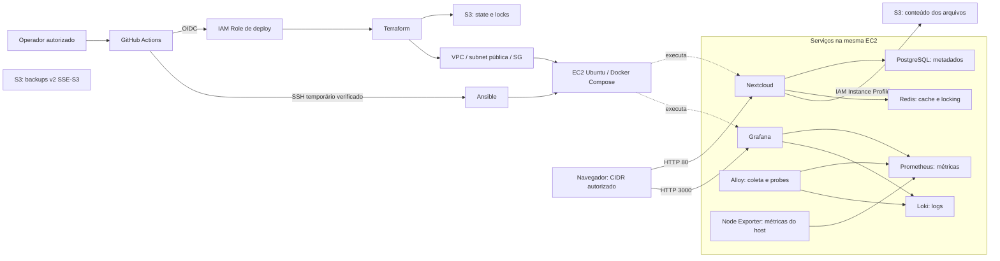

# Nextcloud Platform

> Edição pública de portfólio: snapshot do código e da documentação revisados.
> O repositório operacional, seu histórico, logs e configurações permanecem privados.
> GitHub Actions está desativado nesta cópia; secrets e environments não foram copiados.

**Infraestrutura Cloud e DevOps: provisionamento, configuração e operação de Nextcloud na AWS.**

**Laboratório encerrado em 14/10/2026.** Este repositório apresenta o código,
as decisões e as evidências de deploy, backup e recuperação executados na AWS.
As duas EC2 e suas redes descartáveis foram removidas; não há demonstração online.
Dados e backups S3 foram preservados. O projeto demonstra recuperação funcional
com intervenções administrativas; o ciclo completo sem intervenção e o workflow
de Destroy não foram concluídos.

Para avaliar o projeto, comece pelos [resultados e evidências](docs/portfolio-evidence.md),
pela [arquitetura](#arquitetura) e pelos [limites conhecidos](#recuperação--resultados-e-limites).

Instalar uma aplicação não resolve, por si só, a criação da infraestrutura,
a distribuição segura de credenciais, a repetição do deploy ou o diagnóstico
de falhas. Este laboratório reúne essas responsabilidades em código versionado:
Terraform define recursos e ciclos de vida, Ansible configura Ubuntu e Docker,
e GitHub Actions coordena o deploy autenticado por OIDC.

A arquitetura usa uma EC2 com Docker Compose, PostgreSQL local, Redis e
observabilidade para limitar o número de serviços permanentes e exercitar
a operação do host. S3 guarda o conteúdo dos arquivos com Instance Profile,
sem credenciais AWS estáticas no Nextcloud. Essas escolhas atendem ao escopo
de aprendizado e orçamento do laboratório, com responsabilidades operacionais
e limites de disponibilidade explicitados abaixo.

Na Fase 6, o workflow concluiu um deploy real na AWS: Nextcloud instalado,
integrações PostgreSQL/Redis/S3 verificadas, Grafana e demais serviços
operacionais, ingress SSH temporário removido e plans posteriores sem mudanças.
Na Fase 7, o backup manual e uma restauração automatizada em destino AWS
independente foram executados com sucesso. O operador confirmou acesso e download
no destino recuperado. Em 14/10/2026, a EC2 recriada também recebeu o backup:
sete etapas de restore concluídas, login web e download com SHA-256 igual ao
backup confirmados. O ciclo foi concluído com intervenções administrativas;
o workflow de restore terminou em failure apenas no cleanup SSM, com nenhuma
sessão ativa na conferência final. Destroy seguro e execução sem intervenções
continuam fora dessa comprovação; veja o [resultado](docs/phase-7-reprovisioning.md).
Uma única VM, HTTP sem TLS e ausência de HA limitam o uso ao laboratório.

## O que foi entregue

| Capacidade | Estado e evidência |
| --- | --- |
| Infraestrutura AWS | Provisionada por Terraform; bootstrap/persistent/runtime separados na origem; root restore mistura recursos persistentes e descartáveis |
| GitHub → AWS | OIDC/AssumeRoleWithWebIdentity validado, sem Access Keys permanentes no CI |
| Terraform State | Backend S3 ativo, versionamento e locking nativo validados |
| Configuração do host | Ubuntu/Docker/Compose preparados por roles Ansible |
| Aplicação | Nextcloud instalado automaticamente, PostgreSQL/Redis healthy |
| Primary Object Storage | S3 via Instance Profile; upload confirmado por associação de metadados e objeto |
| Observabilidade | Prometheus, Grafana, Loki, Alloy e Node Exporter operacionais |
| Deploy final | Workflow completo com sucesso; APIs, datasources, dashboard e cleanup verificados |
| Backup manual | Executado com manifesto v2/SSE-S3, integridade e versões verificadas |
| Restore independente | Banco, configurações e 173 objetos recuperados; acesso/download relatados pelo operador |
| Recriação e recuperação do core | Destino recriado e preparado; sete etapas, login e download/hash confirmados em 14/10/2026; intervenções documentadas |
| Destroy seguro automatizado | Pendente; remoção seletiva do runtime não autoriza destroy genérico ou exclusão de dados |
| Encerramento do laboratório | Dois planos administrativos aplicados: 16 + 17 recursos removidos; EC2, discos root e VPCs ausentes; quatro buckets preservados |

Evidências sanitizadas e seus limites estão em [docs/portfolio-evidence.md](docs/portfolio-evidence.md).

## Arquitetura



Os três buckets têm papéis distintos: **conteúdo Nextcloud**, **backups**
e **Terraform State**. Metadados, nomes e diretórios ficam no PostgreSQL;
conservar somente o bucket de conteúdo não recupera toda a aplicação.
Banco/cache e collectors não publicam portas. Grafana mantém a rede interna
de observabilidade e uma bridge dedicada para publicação exclusivamente IPv4.

## Tecnologias e responsabilidades

| Camada | Tecnologias | Responsabilidade |
| --- | --- | --- |
| Cloud | AWS EC2, VPC, IAM, S3 | Computação, rede, identidade e armazenamento |
| IaC | Terraform | Provisionamento, state remoto, locking e plans revisáveis |
| Configuração | Ansible | Pacotes, Docker, arquivos protegidos e execução idempotente |
| CI/CD | GitHub Actions + OIDC | Deploy manual autorizado e autenticação federada |
| Containers | Docker Engine + Compose Plugin | Oito serviços com imagens fixadas por digest |
| Aplicação | Nextcloud, PostgreSQL, Redis | Arquivos, metadados, cache e locking |
| Observabilidade | Prometheus, Grafana, Loki, Alloy, Node Exporter | Métricas, logs, probes, dashboards e alertas locais |

Terraform 1.14.2 é usado no workflow; o provider AWS está fixado em 6.67.0,
com checksums Windows/Linux. Nextcloud validado: 34.0.4. Versões completas e
contratos ficam nas [documentações de componentes](docs/README.md).

## Decisões de arquitetura e otimização de custos

A escolha prioriza um laboratório de uma aplicação, em uma VM, sem requisito
de alta disponibilidade. Consolidar os serviços evita provisionar um cluster
Kubernetes e uma instância de banco separada neste escopo; isso reduz componentes
permanentes, mas transfere manutenção, backup e recuperação ao operador.

| Decisão atual | Benefício para o laboratório | Trade-off e quando reavaliar |
| --- | --- | --- |
| EC2 + Docker Compose | Fluxo direto entre IaC, configuração do host e containers; sem control plane Kubernetes | Host único e capacidade compartilhada; avaliar EKS quando houver necessidade de orquestração Kubernetes, múltiplos nós ou workloads |
| PostgreSQL local | Banco e aplicação usam a mesma capacidade EC2/EBS; permite estudar operação e persistência | Backup, atualização, capacidade e recuperação são responsabilidades próprias; considerar RDS para reduzir operação do banco e configurar recursos gerenciados de backup/disponibilidade |
| Observabilidade na mesma VM | Métricas/logs/dashboards sem uma segunda plataforma gerenciada | Consome RAM/disco da aplicação e compartilha seu domínio de falha; não oferece monitoramento independente da VM |
| Acesso direto, sem NAT Gateway ou load balancer | Menos recursos cobrados e caminhos de rede para o escopo atual | VM em subnet pública, SG restritivo e HTTP de laboratório; TLS e arquitetura de entrada exigem revisão antes de uso real |

EKS gerencia o control plane Kubernetes e oferece uma base para orquestração;
RDS oferece operação de banco gerenciada, backups e opções Multi-AZ conforme
configuração. São alternativas apropriadas quando seus benefícios atendem aos
requisitos da carga e da equipe. A escolha local não demonstra superioridade
de EC2/Compose nem substitui essas capacidades.

EKS acrescentaria custos de cluster e recursos de execução; RDS acrescentaria
custos do banco e armazenamento conforme configuração. A comparação deve
considerar também trabalho operacional, risco e disponibilidade, não só a
fatura cloud. Não foi realizado benchmark ou cálculo de economia percentual.
EC2, EBS, IPv4, tráfego e versões/requests S3 continuam cobrados. Retenção local,
imagens fixadas e sizing parametrizado ajudam a controlar o escopo, mas não
garantem que o disco não encha ou que o orçamento seja respeitado.

Referências: [EKS — responsabilidades](https://docs.aws.amazon.com/eks/latest/userguide/kubernetes-concepts.html),
[EKS — custos](https://aws.amazon.com/eks/pricing/),
[RDS — backups](https://docs.aws.amazon.com/AmazonRDS/latest/UserGuide/CHAP_CommonTasks.BackupRestore.html)
e [RDS — custos](https://aws.amazon.com/rds/pricing/).

## Separação por ciclo de vida

| Root Terraform | Responsabilidade | Destroy operacional planejado |
| --- | --- | --- |
| `bootstrap` | OIDC, role GitHub, permissions boundary da EC2 e bucket de state | Preservar |
| `persistent` | Buckets exclusivos de conteúdo e backups, com proteções | Preservar |
| `runtime` | VPC/subnet/IGW/rotas/SG, key pair, IAM da EC2, EC2 e EBS root | Remover somente após os controles futuros de backup |
| `restore` | Destino de recuperação: infraestrutura descartável e bucket de dados no mesmo state | Exige remoção seletiva; destroy geral não é apropriado |

Essa separação evita remover a autenticação necessária para um próximo deploy.
Bootstrap nasce com administração autorizada e migra seu state para S3; o
workflow opera somente persistent/runtime, com chaves estáveis por conta,
projeto e ambiente. Roots, roles e templates são reutilizáveis com parâmetros
de conta, região, projeto, ambiente, buckets, sizing e CIDRs. Os outputs fornecem
o destino da aplicação, sem trocar IPs manualmente no inventário ou nas URLs.

Essa estrutura mantém identidade e dados separados da VM. O laboratório demonstrou
remoção seletiva do runtime, recriação, preparação e recuperação funcional do core,
com intervenções administrativas e armazenamento preservado. Não demonstrou
destroy genérico, perda do bucket de origem ou automação sem intervenções.
O workflow de Destroy ainda não existe.
No encerramento do laboratório, os dois runtimes foram removidos por planos
administrativos revisados, preservando os dados. O [registro e procedimento](docs/runtime-removal-terminal.md)
distinguem essa execução manual de um workflow de destruição automatizado.

## Por que S3 Primary Object Storage com Instance Profile

O conteúdo dos arquivos é separado do disco de runtime e armazenado no bucket
persistente de dados. Isso evita tratar o EBS da VM como a única cópia do conteúdo
e permite avaliar seu crescimento separadamente da capacidade do host.
Nextcloud usa identificadores de objeto; nomes, diretórios e metadados ficam no
PostgreSQL. A sobrevivência do bucket é apenas parte de uma recuperação futura:
banco e configuração também precisam de um backup coerente.

A IAM Role associada à EC2 por Instance Profile limita as operações ao bucket
de dados. O SDK obtém credenciais temporárias via IMDSv2, sem Access Key/Secret Key
estáticas no config do Nextcloud, no Compose ou no repositório. Isso evita
distribuição e rotação manual de uma chave permanente da aplicação; não elimina
a necessidade de proteger o host, o metadata endpoint e as permissões da role.

OIDC tem outro papel: autentica o runner GitHub para provisionar recursos.
As credenciais desse runner não são repassadas ao Nextcloud. Bucket de backups
e Terraform State permanecem fora do acesso da role da aplicação.
Referência: [IAM Roles para aplicações EC2](https://docs.aws.amazon.com/IAM/latest/UserGuide/id_roles_use_switch-role-ec2.html).

## Fluxo automatizado

1. **Preparação administrativa:** bootstrap e migração de state, feitos uma vez
   por ambiente com revisão e autorização próprias.
2. **Disparo manual:** deploy.yml usa workflow_dispatch, Environment e branch
   autorizada. O padrão é plan; apply exige confirmation=APPLY.
3. **Preflight e OIDC:** validar inputs, secrets/par SSH e identidade AWS;
   syntax-check e lint precedem o provisionamento real.
4. **Terraform:** init remoto, fmt, validate e plan; em apply autorizado, aplicar
   persistent antes de runtime. Plans e state não são artifacts.
5. **Descoberta e SSH:** ler outputs runtime, conferir a instância via API,
   gerar inventário e liberar somente SSH temporário /32 para o runner.
6. **Ansible + Compose:** preparar host, renderizar configurações, preservar
   secrets existentes e subir a stack com detecção de mudanças.
7. **Instalação e validação:** preparar S3 antes da instalação inicial, recusar
   estado incompatível e verificar aplicação, integrações e observabilidade.
8. **Encerramento:** mostrar URLs calculadas pelo IP atual e remover a regra SSH
   temporária e os arquivos sensíveis do runner.

O IP público de destino é dinâmico; os CIDRs administrativos de origem são
entradas separadas. Não há IP real fixado neste README ou Variable de destino
manual. Uma falha preserva os recursos para diagnóstico, sem destroy automático.

## Segurança aplicada

- OIDC com trust restrito e GitHub Environment limitado à branch autorizada.
- IAM por ações/recursos/tags e permissions boundary; sem AdministratorAccess
  ou ec2:*. Role EC2 acessa dados, não backups ou state.
- IMDSv2 obrigatório; credenciais temporárias via Instance Profile no Nextcloud.
- S3 com versionamento, SSE-S3, TLS obrigatório e bloqueio público; sem
  force_destroy=true ou expiração automática. ACL privada compatível com o driver.
- Secrets fora do Git, protegidos no host e não expostos em argumentos/logs.
  Atualização acidental de credenciais existentes é bloqueada.
- SSH com host key verificada; regra do runner identificada por execução e cleanup.
- HTTP/80 e Grafana/3000 restritos a CIDRs administrativos; sem publicação IPv6
  do Grafana, login anônimo ou portas externas de banco/cache/collectors.
- Storage guard preservado: sem troca silenciosa de bucket/região, fallback
  local ou migração automática. Banco parcialmente inicializado exige diagnóstico.

**Limites:** CIDR não substitui TLS; HTTP não criptografa login/sessão. A VM é um
ponto único de falha. Versionamento S3 não é backup completo; volumes locais
dependem do ciclo de vida do runtime. Root no host pode acessar dados/secrets.

## Observabilidade e resultado da Fase 6

Prometheus coleta métricas do host via Node Exporter e probes via Alloy.
Alloy envia logs JSON Docker ao Loki sem Docker socket. Grafana consulta ambos
por datasources provisionados e oferece dashboard e alertas locais de
disponibilidade, memória e disco. Não há observabilidade AWS gerenciada.

Na execução final, persistent ficou sem mudanças e runtime criou somente a
regra administrativa Grafana. Somente Grafana foi recriado; os outros sete
containers e os seis volumes foram preservados. Ansible terminou com failed=0
e unreachable=0. Os plans posteriores dos dois roots foram 0/0/0.

Nextcloud confirmou installed=true; PostgreSQL/Redis/S3 passaram nos probes
autenticados. Grafana respondeu HTTP 200 pelo host; datasources Prometheus/Loki
e dashboard foram validados; API privada retornou 401 sem autenticação.
Cleanup SSH e liberação dos locks S3 foram conferidos na AWS.

Os probes automatizados HTTP ocorreram no host EC2. Separadamente, houve
**validação manual relatada pelo operador**, no navegador, a partir de acesso
administrativo autorizado:

| Serviço | Testes manuais relatados | Resultado |
| --- | --- | --- |
| Nextcloud | Página, login administrativo, upload, download, navegação e utilização | OK |
| Grafana | Acesso direto sem túnel SSH, login, dashboard platform-overview, conexões Prometheus/Loki e visualização de métricas/logs | OK |

São relatos de uso externo, não testes automatizados do GitHub Actions; não
foram fornecidos screenshots ou evidências técnicas adicionais desses testes.
Upload/download não comprova, por si só, inspeção direta dos objetos S3. A
consulta readonly S3 registrada no projeto é uma verificação técnica separada,
não uma conclusão inferida do teste manual. O restore independente da Fase 7
está documentado separadamente. A recuperação no destino recriado foi confirmada
em 14/10/2026, com login web e comparação SHA-256 de um download; Destroy seguro
automatizado permanece pendente.
Ver o
[relatório sanitizado da Fase 6](docs/phase-6.md) e a [matriz de evidências](docs/portfolio-evidence.md).

## Navegação do repositório

```text
terraform/aws/{bootstrap,persistent,runtime}/  # roots do ambiente original
terraform/aws/restore/                        # destino de recuperação; state misto
environments/{lab,customer-template}/         # templates, nunca configurações reais
ansible/{inventory,playbooks,roles}/          # preparação e deploy
docker/                                      # Compose, configuração, guard e testes
monitoring/                                  # métricas, logs, dashboard e alertas
scripts/ci/                                  # controlador e testes do workflow
.github/workflows/                            # deploy, backup, restore e qualificações
docs/                                        # decisões, guias e evidências sanitizadas
```

Comece pelo [índice de documentação](docs/README.md), pelas
[decisões arquiteturais](docs/decisions.md) e pelo [backend S3](docs/terraform-state.md).
Para reproduzir em sua conta, consulte os contratos de
[GitHub Actions](.github/workflows/README.md), [Ansible](ansible/README.md),
[Docker](docker/README.md) e [observabilidade](monitoring/README.md).
Substitua os templates e revise plans, permissões, CIDRs e custos antes de apply.

## Validação e capacidade

Foram executados fmt/validate/plans e testes Terraform com provider mock;
syntax-check/ansible-lint; Compose config; testes estáticos e de regressão do
controlador, storage guard e instalador; PHP lint; actionlint; validadores
Prometheus/Loki/Alloy; scan de secrets e diff-check. A validação real cobriu OIDC,
backends/locking, SSH, deploy e healthchecks. Mocks não comprovam DR.

O laboratório usa t3.medium e root EBS gp3 criptografado de 30 GiB, ambos
parametrizados. Isso é uma referência testada, não sizing definitivo. Uma
amostra sem carga mostrou cerca de 1,3 GiB de RAM usados e 35% de disco utilizado;
capacidade sob concorrência, crescimento e backup/restore ainda deve ser medida.
EC2, EBS, IPv4 público, tráfego e armazenamento/requests/versões S3 geram custos.
Não se pressupõe Free Tier nem se publica estimativa financeira sem medir uso.

## Recuperação — resultados e limites

| Etapa | Entrega pretendida | Critério de conclusão |
| --- | --- | --- |
| Backup manual — executado | Banco, configuração e metadados, com manifesto v2/SSE-S3 | Completion, hashes e versões verificados; depende das versões preservadas no bucket de dados |
| Destroy seguro | Workflow exclusivo runtime, condicionado a backup válido | Preservar bootstrap/persistent; exigir integridade, dependências disponíveis, restore comprovado aplicável e autorização |
| Restore independente — executado | Backup específico restaurado em destino separado em 13/10 | Aplicação healthy e acesso/download relatados pelo operador |
| Recriação e restore do core — demonstrados com intervenções | EC2 recriada preparada e backup específico restaurado em 14/10 | Sete etapas, serviços healthy, login web e download com SHA-256 verificados; workflow failure no cleanup SSM, sem sessão ativa ao final |
| Hardening e testes finais | TLS, revisão de acesso/capacidade e testes de falha | Evidências adicionais; escopo a aprovar |
| Evolução Azure | Adaptar provisionamento, identidade e storage ao novo ambiente | Implementar e validar separadamente; hoje existe somente um placeholder |

Os workflows manuais de backup e restore foram implementados e executados.
Permanecem administrativamente desabilitados fora das janelas autorizadas.
O [PR1 — Contrato de Recuperação](docs/phase-7.md) distingue integridade de prova
funcional; o [PR8](docs/phase-7-pr8.md) registra o resultado real e as evidências
pendentes. A modalidade de backup depende da preservação do bucket de dados e
de suas versões: não protege contra perda completa desse bucket. A remoção seletiva
do runtime preservou os recursos de dados; destroy genérico não foi validado.
Azure permanece apenas um placeholder, sem ambiente implementado.

## Portfólio e apresentação

O material do portfólio é documentação sanitizada, diagrama, matriz de evidências
e referências ao código. Não há screenshots versionados prontos para divulgação.
O [roteiro de capturas](docs/portfolio-evidence.md#capturas-para-uma-apresentação)
explica como registrar workflow, aplicação e dashboard sem dados operacionais.

Senhas, chaves privadas, state, planos, backend configs e tfvars reais ficam fora
do conteúdo versionado. O [registro de revisão para publicação](docs/publication-review.md)
descreve o escopo da auditoria e o tratamento dos históricos operacionais.
As evidências registram execuções anteriores; não representam serviços ativos.
